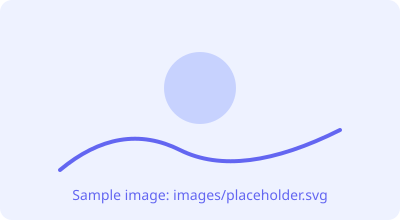

This is a sample post demonstrating how to write articles for this blog. It can be deleted or rewritten.

## How to write a post

1. English posts live under `blog/en/`, Chinese posts under `blog/zh/`. Create a date-named directory, e.g. `blog/en/2026-11-16/`;
2. Create an `index.md` inside it, starting with front matter:

   ```yaml
   ---
   layout: post
   title: Post Title
   date: 2026-11-16
   lang: en          # zh for Chinese posts, en for English posts
   ---
   ```

3. Write the body in Markdown — the post appears automatically in the [English blog listing](/blog/en/) or the [Chinese one](/blog/zh/).

## Referencing images

Put images and other assets inside the post's own directory (e.g. an `images/` subfolder) and reference them with relative paths:



## Markdown support

GitHub-flavored Markdown is supported: tables, task lists, strikethrough, syntax-highlighted code blocks, etc.

```python
from hikyuu.interactive import *

my_tm = crtTM(init_cash=300000)
my_sg = SG_Flex(EMA(CLOSE(), n=5), slow_n=10)
my_mm = MM_FixedCount(1000)
sys = SYS_Simple(tm=my_tm, sg=my_sg, mm=my_mm)
sys.run(sm['sz000001'], Query(-150))
```

| Table | Example |
| ----- | ------- |
| A     | 1       |
| B     | 2       |
