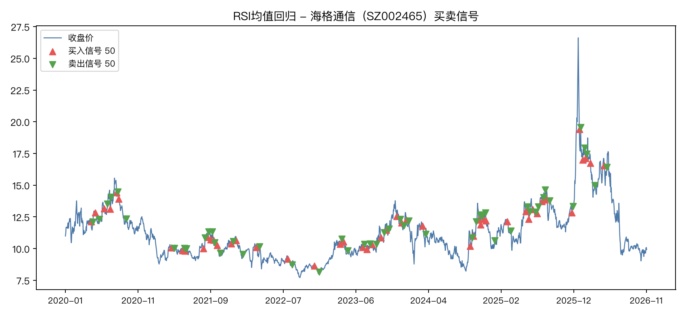
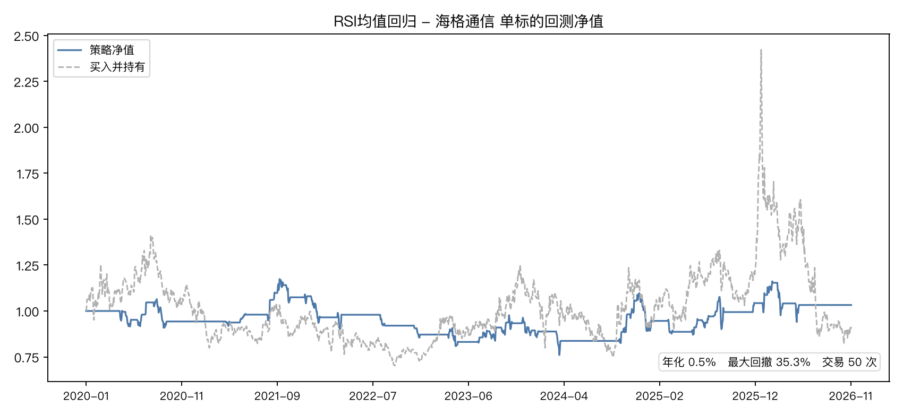
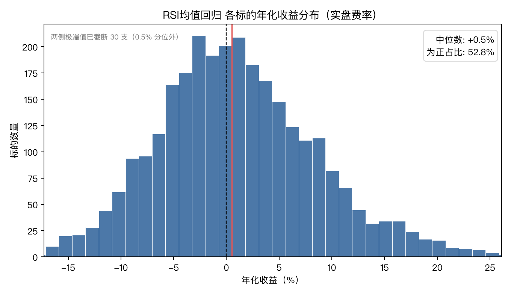
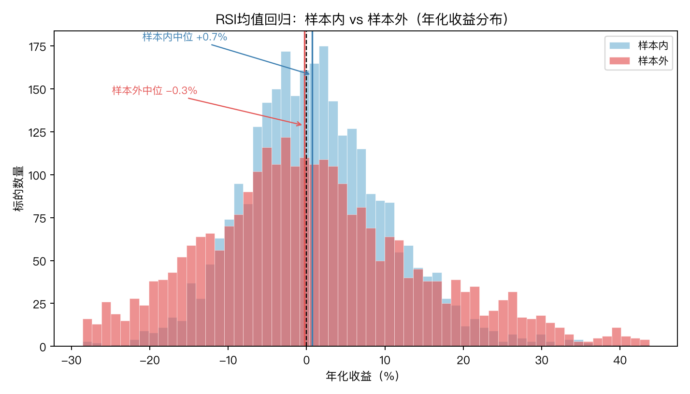
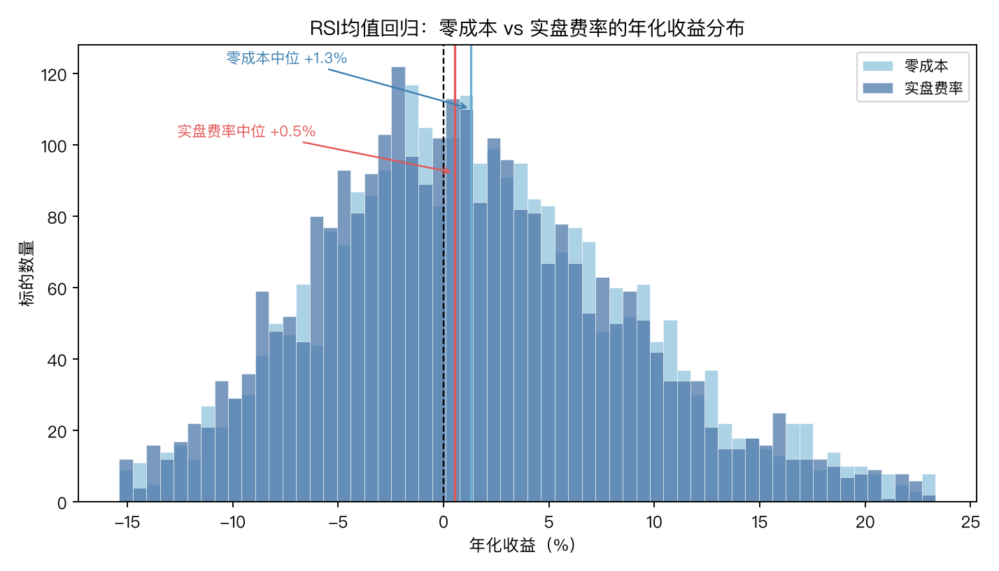

> This article implements RSI mean reversion in Hikyuu and throws it at the entire A-share market to see what happens.
> The goal is to get you through the "change one parameter, test a class of stocks" loop in minutes — not to prove this parameter set makes money.

## Strategy Description

RSI (Relative Strength Index) compares the magnitude of gains and losses over a lookback window and compresses short-term price strength into a single number between 0 and 100. A low reading means losses dominated that window; a high reading means gains did. That is where the mean-reversion idea comes from: instead of chasing a trend that has already played out, take a position when price gets pushed too far in the short term, and exit once strength returns to normal.

But "oversold" does not mean "bottomed" — in a downtrend, RSI can sit at low readings for a long time. So rules of this kind usually add a trend filter, only buying short-term pullbacks while the medium-to-long-term direction is still intact. That is exactly how the system in this article is built.

Buy short-term oversold conditions within an uptrend: buy when the close is above the n-day moving average and RSI is below the oversold threshold; close the position when RSI rises above the overbought threshold.

As for parameters: n is the trend-filter moving-average period, rsi_n is the RSI period, buy_th is the RSI oversold buy threshold, and sell_th is the RSI overbought sell threshold.

In Hikyuu, this rule set is assembled from the components below, using each component's default parameters.

| Component | Name |
| --- | --- |
| Signal generator SG | `SG_Add` = `买入RSI超卖` (buy RSI oversold) + `卖出RSI超买` (sell RSI overbought) |
| Money management MM | `MM_Nothing` |
| Stop-loss ST | `not set` |
| Take-profit TP | `not set` |
| Profit goal PG | `not set` |
| Slippage SP | `not set` |

The signal is composed by adding two sub-signals (`SG_Add`): `买入RSI超卖` (the buy side of `SG_OneSide`) fires a buy when the close is above the n-day moving average and RSI is below buy_th; `卖出RSI超买` (the sell side of `SG_OneSide`) fires an exit when RSI is above sell_th. Both sub-signals trigger on the bar's closing price; after composition, buy/sell alternation is enabled so entries and exits are issued as one unified signal. How much to buy per trade is decided by MM; with no stop-loss or take-profit attached, a position is held until the opposite signal appears.

The implementations of these two sub-components in the hub are as follows:

```python
# hikyuu_hub/part/sg/买入RSI超卖/part.py
def part(n: int = 70, rsi_n: int = 2, buy_th: float = 10.0):
    cond = (CLOSE() > MA(CLOSE(), n)) & (RSI(CLOSE(), rsi_n) < buy_th)
    ret = SG_OneSide(cond, True)
    ret.name = "买入RSI超卖"
    return ret
```

```python
# hikyuu_hub/part/sg/卖出RSI超买/part.py
def part(rsi_n: int = 2, sell_th: float = 90.0):
    cond = RSI(CLOSE(), rsi_n) > sell_th
    ret = SG_OneSide(cond, False)
    ret.name = "卖出RSI超买"
    return ret
```

(Note: the component names in the hub are in Chinese; they are kept as-is in the code so it runs unchanged.)

## Reading the Signals from a Chart

Attach the components to a single stock and first look at what the signals look like.

```python
from hikyuu.interactive import *

start_date = Datetime(20200101)
query = Query(start_date)
stk = sm['sh603608']
k = stk.get_kdata(query)

my_sys = get_part("dev.sys.RSI均值回归")
my_sys.tm = crtTM(start_date, init_cash=100000, cost_func=TC_FixedA())
my_sys.run(k)
my_sys.sg.plot()      # signal points
```



*Note: the charts in this article currently retain their original Chinese labels (titles, axes, and legends); English versions will replace them later. Key terms: 买入信号 = buy signal, 卖出信号 = sell signal, 账户净值 = account equity, 日期 = date, 价格 = price.*

The triangles mark the buy and sell points. On Tianchuang Fashion (SH603608), the RSI mean-reversion system fires roughly 7.7 signals per year — get a clear picture of whether this is "frequent in-and-out" or "long holding" before talking about performance.

## Single-Stock Backtest

```python
my_sys.performance()
```



On Tianchuang Fashion (SH603608): cumulative -42.0%, annualized -8.2%, max drawdown 64.4%, 52 trades.

Here is how to read it: what a single-stock system evaluates is **the expectancy of this rule itself**, not how it stacks up against anything else. Staying in cash is its counterparty, so what matters is whether the equity curve itself has a positive slope and whether the drawdown is bearable — not how many points it gained relative to some index.

## Performance Across the Entire A-Share Market

First, the evaluation basis: a single-stock system evaluates **the expectancy of its own timing decisions** — it has no benchmark; cash is the opponent. So we do not look at "relative to buy-and-hold" here; we look at each stock's own equity result.

```python
keys = ["Account CAGR %", "Total Closed Trades",
        "Win Rate %", "Avg Win / Avg Loss Ratio", "Profit Factor"]
df = analysis_sys_list(stks, query, my_sys, keys=keys)
df[keys].describe()
```



Running each stock independently: median annualized return **-1.6%**, 25th–75th percentile **-5.9% ~ +3.5%**, and **41.4%** of stocks end up positive.

Trade-sequence statistics (median across stocks):

| Metric | Median | Reference threshold |
| --- | --- | --- |
| Profit Factor | **0.93** | ≥ 1.3 |
| Win rate | 58.3% | — |
| Payoff ratio (avg win / avg loss) | 0.67 | Multiplied with win rate determines expectancy |
| Number of trades | 45 | ≥ 30 for statistical significance |

**By the single-stock system's own standard, this rule set does not have positive expectancy**: median Profit Factor 0.93 (below the 1.3 passing line), median annualized return -1.6%, and only 41.4% of stocks positive. A high win rate does not help — many wins that each earn little, few losses that each cost a lot; multiply them together and it still nets to zero.

Mean reversion has the shape of "high win rate, low payoff ratio": many winning trades that each earn little, few losing trades that each cost a lot. In this shape the win rate looks pretty, but what actually decides survival is the payoff ratio and costs — a 0.67 payoff ratio paired with a 58% win rate multiplies out to almost exactly zero.

> For reference: over the same period, the median **annualized** buy-and-hold return of this pool was -0.6%. The single-stock system does not use it as a benchmark; it is provided only as an order-of-magnitude reference.

## Out of Sample: Throwing the Same Rule at an Unseen Period

All the numbers above come from the same stretch of history. The real question is not "does it make money in sample" but "does it still hold up on a period it has never seen" — here we split the range in two: in-sample 2020-01-01 ~ 2024-10-15, out-of-sample 2024-10-15 ~ 2026-11-06. Not a single character of the rule changed; only the data did.



| Basis | Median CAGR | Share positive | Median Profit Factor |
| --- | --- | --- | --- |
| In-sample (2020-01-01 ~ 2024-10-15) | -1.45% | 42.6% | 0.91 |
| Out-of-sample (2024-10-15 ~ 2026-11-06) | -2.34% | 42.0% | 0.88 |

**In-sample already failed the test (median CAGR -1.5%, PF below the threshold), and out-of-sample stays negative at -2.3%** — the two periods agree, which shows the sliver of positive values in sample carries no statistical weight. This is not a "it would work in a different market regime" problem.

> The out-of-sample window is only 2.0 years across 2,899 stocks; a single window can itself be luck. A more rigorous approach is rolling multiple windows (walk-forward); what we give here is the cheapest possible first check.

## Cost Basis: Same Rule, Zero Cost vs Realistic Fees

All the numbers above are after fees. But how much the fees take out is more worth looking at than the result itself — with the same signals, changing only the fee assumption can flip the direction of the conclusion.



| Basis | Median CAGR | Share positive |
| --- | --- | --- |
| Zero cost | +1.31% | 57.1% |
| Realistic fees | -1.57% | 41.4% |
| Difference | 2.88pp | — |

**Median annualized return is +1.3% at zero cost and turns into -1.6% after fees** — costs eat the profit clean; what this rule earns is not even enough to pay the toll. Lower turnover or lower commissions are the only directions that could possibly pull it back to positive expectancy.

The median cumulative cost per stock is about ¥18,600, averaging ¥413 per trade. The code change is a single line: swap `cost_func` for `TC_Zero()` and run again, everything else untouched.

```python
my_sys.tm = crtTM(start_date, init_cash=100000, cost_func=TC_Zero())
df_zero = analysis_sys_list(stks, query, my_sys, keys=["Account CAGR %"])
```

Methodology notes: 2020-01-01 to latest; the stock pool is the 2,899 A-shares listed before 2020-01-01 and still listed today; default execution timing (next day's open); costs use `TC_FixedA()` (commission 18.0 bps, i.e. 0.18%, with a ¥5 minimum; stamp duty 0.5‰ on sells only; transfer fee 0.01‰); slippage not included — attach `SP_FixedPercent(0.001)` if needed; both strategy and benchmark sides use unadjusted closing prices, so ex-dividend events understate holding returns — for more rigor, switch both sides to adjusted prices.

## Back to the Opening Question

How to build, run, and read this rule set in Hikyuu — the steps above have walked through all of it; and whether it actually works, the numbers have answered too — after costs, it does not make money.

Keep two things separate: **the framework answers "can it be verified"; the rule answers "is it worth doing"**. The former is reusable; the latter must be re-answered for every new rule set, and the answer can only come from running your own data.

> Every number in this article comes from the code snippets above. Swap a component, swap a stock pool, and the same steps will produce your own conclusion.

The component implementations used in this article are published in hikyuu_hub for reference: <https://github.com/fasiondog/hikyuu_hub>

*This article is for quantitative strategy research and educational exchange only and does not constitute investment advice. Investing involves risk; investors should judge independently based on their own circumstances and bear the corresponding risks.*

**Hikyuu Quant Framework is an open-source quantitative trading research framework based on C++/Python**, providing high-performance infrastructure for quant enthusiasts and professionals. Project repositories:

* <https://github.com/fasiondog/hikyuu.git>
* <https://gitee.com/fasiondog/hikyuu.git>
* <https://gitcode.com/hikyuu/hikyuu.git>