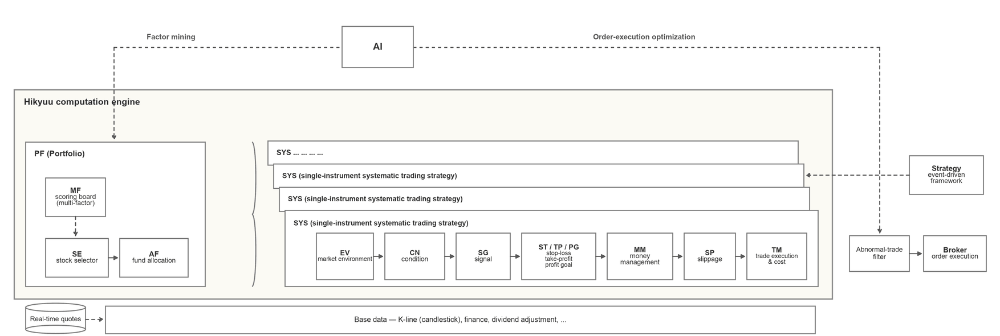

.. figure:: _static/00000-title.png

About Hikyuu
============

An open-source quantitative research framework in C++/Python — a high-performance engine that puts
financial and trading correctness first, with portfolios isomorphic to strategies, nestable to any
depth, and freely replaceable components. Deeply adapted to the Chinese A-share market; the core
library can be detached and used standalone, with the Python interface layer and
``hikyuu.interactive`` built on top of it.

**Hikyuu's kernel is the completeness and correctness of trading theory and financial semantics**: how
a trade should financially come into existence — when it fills, which items make up its cost, how
positions and cash change on ex-rights / ex-dividend dates, which convention performance follows, how
nulls and non-finite values propagate — is **complete and explicit** in the framework: no missing
links, rules that are actually executed, and results that can be verified item by item, rather than
left to the user to guarantee.

**Its purpose, in two sentences: never let a strategy that "runs" but does not hold up be taken as a
conclusion; and never let a full-market validation become waiting.**

**Speed is not fewer steps — it is what makes "verify every step" affordable on an ordinary machine**:
on an Orange Pi 5 Plus (an ARM single-board computer), a full ``SYS_Simple`` run for each of the 3,547
currently valid non-index securities over the eleven years 2015–2026 — the EMA5 self-cross with its own
EMA10 from ``SG_Flex(EMA(C, 5), slow_n=10)`` plus ``MM_FixedCount(100)``, each on its own ledger, on
warm data and walking them in a single serial process — takes about 13 seconds.

Two means serve the first sentence: **splitting the structure along theoretical questions** — a
strategy must answer market environment, condition, signal, position sizing, exit and fill price; a
portfolio must answer who participates, how much money each gets and by what score — each is a
theoretical must-answer question, not an engineering module; and **portfolio as strategy** — making
the portfolio a first-class citizen (``SE`` / ``AF`` / ``MF``) is what lets the kernel extend from a
single strategy to multi-asset, multi-strategy. Every link can then be replaced and evaluated
independently, and every trade is recorded in a queryable ledger; the value of the framework is not
exhaustive coverage, but **getting every slot right and keeping the contract intact after
replacement**; speed comes from the same C++ kernel — the same ledger, the same guards, only without
an interpreter in between.

Project repositories:

* `GitHub <https://github.com/fasiondog/hikyuu>`_
* `Gitee <https://gitee.com/fasiondog/hikyuu>`_
* `GitCode <https://gitcode.com/hikyuu/hikyuu>`_

Project home page: `https://hikyuu.org/ <https://hikyuu.org/>`_

Documentation: `https://hikyuu.readthedocs.io/en/latest/index.html <https://hikyuu.readthedocs.io/en/latest/index.html>`_

Getting started: `https://nbviewer.org/github/fasiondog/hikyuu/blob/master/hikyuu/examples/notebook/en/000-Index.ipynb?flush_cache=True <https://nbviewer.org/github/fasiondog/hikyuu/blob/master/hikyuu/examples/notebook/en/000-Index.ipynb?flush_cache=True>`_

Strategy part library: `https://gitee.com/fasiondog/hikyuu_hub <https://gitee.com/fasiondog/hikyuu_hub>`_

Thanks to a community member who provided an Ubuntu virtual machine image with Hikyuu preinstalled;
download it from Baidu Netdisk (extraction code: ht8j): `download <https://pan.baidu.com/s/1CAiUWDdgV0c0VhPpe4AgVw?pwd=ht8j>`_

Example code:

::

    # create a simulated trading account for backtesting, with initial capital of 300,000
    my_tm = crtTM(init_cash = 300000)

    # create a signal generator (fast line: 5-day EMA; slow line: 10-day EMA of the 5-day EMA;
    # buy when the fast line crosses above the slow line, sell otherwise)
    my_sg = SG_Flex(EMA(CLOSE(), n=5), slow_n=10)

    # buy a fixed 1000 shares each time
    my_mm = MM_FixedCount(1000)

    # create the trading system and run it
    sys = SYS_Simple(tm = my_tm, sg = my_sg, mm = my_mm)
    sys.run(sm['sz000001'], Query(-150))

.. figure:: _static/10000-overview.png
        :width: 600px

The complete example is available in the `Getting Started Notebook <https://nbviewer.jupyter.org/github/fasiondog/hikyuu/blob/master/hikyuu/examples/notebook/en/000-Index.ipynb?flush_cache=True>`_

Before you start: what it is, and what it is not
------------------------------------------------

.. note::

   **It is not an automated trading tool, nor an order execution system**: it does not embed broker
   connectivity, promise automatic order placement, or do tick-level matching or low-latency
   execution; ``OrderBroker`` is merely a pluggable interface — whether to connect one, and to which
   channel, is the user's own decision and compliance responsibility. It advances bar by bar and
   executes the financial semantics of a trade in full according to real rules; the decisions remain
   the user's. Matching microstructure (partial fills, cancellations, order queues) and modern
   portfolio optimization (mean-variance, risk parity) are no exception: the framework does not pick
   such algorithms for you, but it keeps the slots ready — matching plugs in via ``OrderBroker`` and
   fill models, portfolio optimization takes an ``AF`` subclass, and the same applies to ``SE`` /
   ``MF`` / ``MM`` / ``ST``. **The point of the framework is not to write all the algorithms, but to
   keep every slot right: each slot is replaceable, and settlement and validation still hold after
   replacement.**

**The barrier is kept on purpose**: the framework will not use a pretty curve to make up for the
premises you never thought of. You have to understand these links yourself — otherwise all you get is
the illusion of something that runs.

From another angle, it works more like a map: it lists item by item what building a strategy should
take into account (environment → condition → signal → sizing → exit → slippage → cost; portfolio
layer: selection → fund allocation → risk control). Fill it in item by item and the path itself is
the way in. **It suits people who want to study systematic trading seriously** — self-learners and
students included — not those who want a return curve in two days.

.. epigraph::

   "If you don't bet, you can't win. If you lose all your chips, you can't bet." — Larry Hite

A few words for beginners and self-learners:

* **Get the flow running first; talk about returns later**: a backtest return is not proof of ability
  — being able to explain why every trade filled is.
* **Change one part at a time**: keep the other links fixed as a control, or you cannot tell where a
  change in results came from.
* **Get costs and equity adjustments right before tuning parameters**: parameters "optimized" without
  cost constraints are usually just fitting noise.
* **Care about "in what environment it fails"**: that is more useful than "how much it made
  historically"; test with out-of-sample and walk-forward validation (``SYS_WalkForward``) instead of
  re-tuning on the same window.
* **Be careful with what is off by default**: leverage and short selling are deliberately disabled by
  default; understand margin, forced liquidation and borrow costs before turning them on explicitly.

Trading theory and financial semantics: complete and correct
-------------------------------------------------------------

Three layers, each owning one thing — miss one and it does not hold: **trading theory** — no missing
link; without the portfolio layer, multiple strategies are just parallel backtests. **trading rules** —
the rules must be right; without equity adjustments and itemized costs, ex-rights days and cross-year
returns are distorted, and without filling-time constraints, a signal filled on its own bar is
look-ahead. **calculation** — null semantics must be consistent; left to each indicator, one ``inf``
pollutes every downstream window aggregation. All three are explicit objects and global conventions in
the framework — enforced by the framework and guarded at the entry points, not by a reminder in the
docs.

.. list-table::
   :header-rows: 1

   * - Layer
     - What it answers
   * - Trading theory
     - Which parts make up a strategy; which layers organize a portfolio
   * - Trading rules
     - How a trade fills, pays fees, adjusts for equity events and is priced in the market
   * - Calculation
     - How nulls and numbers stay consistent along the whole computation chain

**Trading theory**: the split follows theoretical structure, not code responsibilities — a strategy
must answer market environment (``EV``), condition (``CN``), signal (``SG``), position sizing
(``MM``), exit (``ST`` / ``TP`` / ``PG``) and fill price (``SP``); a portfolio must answer who
participates (``SE``), how much money each gets (``AF``: L1 weights / L2 conversion / L3 risk control)
and by what score (``MF``). Each is a theoretical must-answer question; miss one and the strategy is
incomplete.

**Trading rules**: fills are delayed to the next bar's open by default (``buy_delay`` / ``sell_delay``);
a one-price board (high == low) or a trading suspension defers the fill, and it is abandoned beyond
``max_delay_count``; the slippage price is clamped to the day's ``[low, high]``. Costs are itemized
per ``CostRecord`` (commission / stamp duty / transfer fee) and computed separately for buys and
sells; ``updateWithWeight`` adjusts positions and cash on ex-rights / ex-dividend events; margin
financing and securities lending are off by default; performance is annualized on net assets and
calendar days (``duration / 365``).

**Calculation**: undefined states (division by zero / zero variance / all-missing / zero benchmark)
produce ``Null`` (NaN), not ``0.0`` or ``inf`` — ``0.0`` collides with a legitimate zero and ``inf``
pollutes downstream aggregation; aggregations accumulate only finite values and count only valid
entries in the denominator (one for a mean, two for dispersion), producing ``Null`` only when
everything is missing; serialization stores IEEE bit patterns, so NaN / ±Inf / signed zero round-trip
losslessly. Trading inputs are constrained the same way: a non-finite or non-positive size, or a
non-positive fill price, is discarded; a negative rebalance cycle raises immediately. Nulls and
finite values are a **global contract rather than a per-part choice** — new parts inherit the same
convention automatically.

These three layers are not documentation promises: 1,300+ explicit guards in the core code catch rule
and input-boundary violations; 1,600+ doctest cases with 16,000+ assertions are organized "one suite
per module, one case per boundary", covering empty inputs, ``Null<T>()``, non-finite values and
out-of-range exceptions; ``small-test`` runs on the three-platform CI without real market data.

.. note::

   To bypass these rules you can only change parameters explicitly — **the framework takes the side of
   "holding up as a trade" rather than "being the least trouble to run"**. This is also a common
   reason why the same strategy shows different returns across frameworks: whatever is left unmodeled
   depends on the user remembering to make it up.

   The trade-off has a cost: the same strategy usually shows lower returns than an idealized backtest
   — fees deducted, fills waited for, equity events adjusted. Better an ugly backtest number than
   letting a runnable-but-wrong result pass as a usable strategy.

Portfolio as strategy: one engine covering systematic trading / asset allocation / multi-factor
------------------------------------------------------------------------------------------------

**A portfolio and a strategy are the same thing**: a portfolio node is not "a set of weights" — it
holds a full set of trading semantics of its own. The sub-systems' ``EV`` / ``CN`` / ``SG`` / ``MM`` /
``ST`` / ``TP`` / ``PG`` / ``SP`` decide *how to trade*; the ledger (``TM``) records fills and
positions trade by trade, computes costs item by item and adjusts for equity events; the execution
layer handles next-bar fills, retries on failure and trading suspensions — these three layers still
hold on the portfolio node, merged into a single account only at the outermost level.

The portfolio layer therefore answers only the two questions a portfolio should answer: **who
participates** (``SE`` selection, ``MF`` multi-factor scoring) and **how much money each gets**
(``AF``: L1 weights / L2 conversion / L3 portfolio risk control).

This is not a naming refinement but three directly usable consequences:

* **A node is a complete trading system, not a money-allocation slot** — a single system, a
  walk-forward system, a custom Python system, or a portfolio itself can all be attached as a node of
  a parent portfolio, with no adapter layer; there is no depth limit (duplicate additions and circular
  references are rejected).
* **Financial semantics sit on every node** — stop-loss, itemized costs, equity adjustments and
  delayed fills in a sub-system keep working unchanged after joining a portfolio.
* **The three layers of ``AF`` are independently replaceable (mode A)** — swapping the weight source
  (``AF_EqualWeight`` / ``AF_FixedWeightList`` / ``AF_MultiFactor``) does not touch L3 risk control,
  and changing L3 does not touch the L1 weights; mode B allocates quotas with sub-manager autonomy and
  skips the L3 clipping.

.. code-block:: python

    from hikyuu.interactive import *

    # each sub-system is a complete systematic trading system: its own SG / MM / ST and ledger
    def make_leaf(code, sg):
        sys = SYS_Simple(tm=crtTM(init_cash=100000), sg=sg,
                         mm=MM_FixedPercent(0.5), st=ST_FixedPercent(0.05))
        sys.to = sm[code].get_kdata(Query(-500))    # bind its own K-line
        return sys

    trend = make_leaf("sh600000", SG_Cross(EMA(CLOSE(), n=5), MA(CLOSE(), n=60)))
    grid = make_leaf("sh600004", SG_Cross(EMA(CLOSE(), n=3), MA(CLOSE(), n=10)))

    # the portfolio factory does only what a portfolio should do: who participates (SE) + how much
    # money each gets (AF)
    group = PF_SignalAggregate(tm=crtTM(Datetime(202001010000), 300000), adjust_cycle=5)
    group.add(trend)
    group.add(grid)

    # this portfolio can itself participate as a node of a larger portfolio
    top = PF_Simple(tm=crtTM(Datetime(202001010000), 1000000),
                    af=AF_FixedWeightList([0.6, 0.4]), adjust_cycle=5)
    top.add(group)
    top.add(make_leaf("sh600005", SG_Cross(EMA(CLOSE(), n=10), MA(CLOSE(), n=30))))

    # one run: the whole portfolio settles in a single account
    top.run(Query(-500))
    print(top.tm.get_funds().total_assets)

The same engine supports three portfolio run modes, each with its own factory (an existing portfolio
can also switch explicitly via ``set_mode``):

.. list-table::
   :header-rows: 1

   * - Factory
     - Account topology and money flow
     - Methodology
     - Typical scenarios
   * - ``PF_SignalAggregate`` (mode A)
     - Sub-systems run on fixed shadow accounts purely as signal sources; the parent converts their
       intents into execution orders through the AF's L2 conversion, applies L3 portfolio risk control
       and orders uniformly
     - Signal / view aggregation and portfolio construction; multi-factor scores can drive selection
       or weights
     - Overlaying multiple strategy views on one instrument pool; factor-weighted selection
   * - ``PF_Simple`` (mode B)
     - On rebalance days the AF allocates a quota to each sub-system; sub-systems decide autonomously
       within their quota and the parent passes their orders through
     - Asset allocation and rebalancing: weights / risk budgeting / rebalance cycle
     - FOF / MOM, core-satellite, periodic rebalancing
   * - ``PF_WithoutAF`` (mode C)
     - No shadow accounts; sub-systems trade directly on the parent's real account using their own MM
     - Parallel execution of systematic trading: each system keeps its full decision chain
     - Reproducing the legacy ``Portfolio`` backtest semantics; multiple strategies sharing one cash
       pool

When personal capital is limited and strategies are many, mode A is more practical: sub-systems act
as signal sources only and hold no capital; the parent account synthesizes the views into a net
position and orders uniformly, avoiding the fragmentation of "each strategy gets a slice too small
for one lot". Mode B fits scenarios where capital can be partitioned and accounted for independently.

The three modes are not mutually exclusive: within one portfolio you can replace ``SE`` / ``AF`` /
``MF``, and a portfolio of one mode can be a node of another (e.g. an outer mode B allocating quotas
to an inner mode A), layer by layer. Multi-factor is not a separate switch: it plugs into both A and B
paths through ``SE_MultiFactor`` (score-based selection) and ``AF_MultiFactor`` (weights from the SE
scores).

Rebalance days are set by ``set_adjust_cycle(n)`` or ``set_adjust_dates([...])``; sub-system cash is
reclaimed on rebalance days and reallocated by the AF, so the cash released by a sub-system's
stop-loss / take-profit flows back to the portfolio layer on the next rebalance day
(``set_adjust_cycle(1)`` settles every trading day).

.. warning::

   Two prerequisites: every sub-system keeps its own independent SG / MM (sharing them means they
   overwrite each other); ``run(kdata)`` requires each sub-system to have bound its own K-line —
   otherwise use ``run(Query(...))`` driven by the trading calendar. The architecture supports
   multiple markets; the built-in importers currently cover the A-share market, and other assets plug
   in via custom data drivers or plugins.

**A team's or an individual's strategy pool can be backtested as a whole or accounted for
separately**: build each strategy as an independent node — regardless of instrument or author, they
keep their own signals, sizing and stop-loss; the portfolio layer decides who participates and how
much money each gets, and the parent account produces the overall performance. In modes A / B every
sub-system keeps its own ledger, so you can look at the whole and at the contribution of one strategy
at the same time; the hierarchy can be organized as "team → group → member" using the same nesting
mechanism as strategies.

Differences from common practice
~~~~~~~~~~~~~~~~~~~~~~~~~~~~~~~~~

The two common approaches each fit different workflows; the difference is who carries these links:
one runs several strategies side by side on one account in an event-driven framework, with no
portfolio layer modeled — who participates, how much money each gets and when to rebalance are yours
to wrap; the other turns signals / factors into matrices for an optimizer or model, getting a set of
weights whose order sizes, stop-loss, take-profit, fill timing and costs live in a separate execution
layer that is not one abstraction with the strategy.

.. list-table::
   :header-rows: 1

   * - Dimension
     - Event-driven parallel strategies
     - Vectorized factor / signal research
     - Hikyuu
   * - Hierarchy model
     - Strategies side by side on one account, no portfolio layer
     - Signal matrix → portfolio weights → separate executor
     - Portfolio and strategy are isomorphic, arbitrarily deep nesting
   * - Portfolio-layer duties
     - Hand-written wrapper for allocation and rebalancing
     - Weights come out of the optimizer / model
     - ``SE`` selection + ``AF`` (L1 weights / L2 conversion / L3 risk control) + ``MF`` scoring built in
   * - Trading semantics
     - Implemented by each strategy
     - Carried by a separate executor, not one abstraction with the strategy
     - ``EV`` / ``CN`` / ``SG`` / ``MM`` / ``ST`` / ``TP`` / ``PG`` / ``SP`` + itemized costs, equity
       adjustments, delayed fills and retries
   * - State synchronization
     - Shared cash pool; sub-systems influence each other only indirectly
     - No day-by-day state machine
     - At the open / close stages of the same bar, the parent account keeps one set of books
   * - Compute kernel
     - Mostly interpreted implementations
     - Vectorized acceleration
     - C++ kernel + native multi-threading, with optional local vectorized compilation (the ``local``
       option)
   * - AI takeover granularity
     - Generate a whole strategy or parameter set
     - Generate factors / portfolio weights
     - Can go down to a single part; the rest stays framework-managed

If you only do factor research in a vectorized environment, the division of the other two lines is
not necessarily a problem; Hikyuu's choice is to bring the portfolio layer and trading semantics into
one abstraction, at the cost of one more structural layer to understand.

**The difference is not whether you can compose, but the blast radius of mistakes**: commercial tools
leave the portfolio layer to your scripts — allocation, cash constraints, rebalancing and
reconciliation live in the same block of code, and one mistake makes the whole book wrong; Hikyuu
splits the portfolio layer into selection ``SE``, fund allocation ``AF`` (L1 weights / L2 conversion /
L3 risk control) and scoring ``MF``, with default implementations. When customizing you answer only
"how much each gets", while settlement, reconciliation, cash limits and fees stay with the framework.

By the standard of "structure split along trading theory, every slot replaceable, contracts intact
after replacement", we have not seen a second implementation among publicly visible open-source
frameworks.

AI applicability: takeover granularity and integration cost
~~~~~~~~~~~~~~~~~~~~~~~~~~~~~~~~~~~~~~~~~~~~~~~~~~~~~~~~~~~~

Consider a concrete task: **let AI optimize only the take-profit, while entries and sizing keep the
existing rules**. In most frameworks the cost of this is not training but rewiring: the exit logic
sits inside the strategy class, and pulling it out, exposing account state to the outside and making
the reward reflect real fills and costs takes a thick wrapper layer. In Hikyuu the take-profit is
already an independent object (``TP``): write a ``TP`` subclass and nothing else moves.

.. list-table::
   :header-rows: 1

   * - Three things AI integration must solve
     - Most frameworks
     - Hikyuu
   * - Pull out the decision point
     - Edit the strategy code, or generate the whole strategy
     - Parts are already objects; swap one
   * - Host account and position state
     - Maintain it yourself, or expose internals
     - Hosted by ``TM``; read directly via ``get_funds(dt)``
   * - Make the reward reflect real friction
     - Rebuild costs / equity adjustments / fill conventions
     - NAV already net of costs, equity-adjusted, filled at real timing

Both costs shrink at once: the **search space** narrows from "strategies × parameters" to "the output
of one part"; the **experiment cost** drops from "build an adapter layer" to "write one part". Add the
determinism of bar-driven execution (episodes are replayable) and entry guards (illegal configurations
fail early), and you can first confine AI to a narrow experiment on one part, then widen the takeover
step by step.

.. note::

   Current state: ``runMoment`` / ``get_funds(dt)`` / ``get_performance(dt)`` provide the ``step`` /
   ``state`` / ``reward`` primitives, and the part contract (``clone``, serialization, parameter
   enumeration) supports search and evolution; walk-forward optimization is built in
   (``SYS_WalkForward`` with ``SE_MaxFundsOptimal`` / ``SE_PerformanceOptimal`` /
   ``SE_EvaluateOptimal``). A thin Gym-style wrapper with example-level feature and reward references
   is planned; the trainer stays outside.

Core parts of the systematic trading architecture
---------------------------------------------------

The project consists of three parts — a **C++ core library**, a **Python interface layer** and an
**interactive exploration tool** — and every part can be replaced and combined freely:

* **C++ core library (``hikyuu_cpp/hikyuu``)**: a complete strategy framework with native
  multi-threading and multi-core acceleration, leaving room to scale for very high computing demands;
  it can be detached and used standalone to build custom quantitative tools quickly.
* **Python interface layer (``hikyuu``)**: a lightweight wrapper around the C++ core with TA-Lib
  integrated; converts seamlessly to and from numpy and pandas, so it plugs into the mainstream Python
  data analysis ecosystem.
* **hikyuu.interactive**: built-in visualization of candlesticks, indicators and signals, suitable for
  rapid strategy validation and backtest analysis; both object-oriented and command-line styles are
  supported, and the command-line style is minimal and expressive for quick idea validation.

The data layer supports four storage backends: **HDF5 / MySQL / ClickHouse / SQLite** (HDF5 by
default; ClickHouse comes as a plugin — it reads and writes minute-level data faster than HDF5 and uses
far less space than MySQL, fitting minute-level and higher-frequency data better).

This table is the **slot list of the domain model**: every row is a replaceable slot (``EV`` / ``CN`` /
``SG`` / ``MM`` / ``ST`` / ``TP`` / ``PG`` / ``SP``; ``SE`` / ``AF`` / ``MF``) — swap any one and
settlement, costs and validation remain with the framework.

.. list-table::
   :header-rows: 1

   * - Layer
     - Part
     - Description
   * - Portfolio layer
     - ``PF_*`` (portfolio factories; ``Portfolio`` is a compatibility alias)
     - Multi-asset, multi-strategy portfolios: selection, fund allocation and unified accounting
   * - Portfolio layer
     - ``Selector / SE``
     - System / strategy screening
   * - Portfolio layer
     - ``AllocateFunds / AF``
     - Fund allocation: portfolio-level L1 weights / L2 conversion / L3 risk control
   * - Portfolio layer
     - ``MultiFactor / MF``
     - Multi-factor model: factor scoring and ranking
   * - Trading system SYS
     - ``Environment / EV``
     - Market environment: validity assessment of the broad market regime
   * - Trading system SYS
     - ``Condition / CN``
     - Condition: situations where the system applies
   * - Trading system SYS
     - ``Signal / SG``
     - Signal generator: produces buy / sell signals
   * - Trading system SYS
     - ``MoneyManager / MM``
     - Money management: order size control
   * - Trading system SYS
     - ``Stoploss / ST``
     - Stop-loss: risk-control exit
   * - Trading system SYS
     - ``Takeprofit / TP``
     - Take-profit: exit when the target level is reached
   * - Trading system SYS
     - ``ProfitGoal / PG``
     - Profit goal: exit when the target is reached
   * - Trading system SYS
     - ``Slippage / SP``
     - Slippage: price simulation in backtesting
   * - Trade management
     - ``TradeManager / TM``
     - Trade manager: account cash and position records
   * - Trade management
     - ``OrderBroker / OB``
     - Order broker: broker connection for live trading
   * - Data layer
     - ``StockManager``
     - Unified security management
   * - Data layer
     - ``KData``
     - K-line price / volume series
   * - Data layer
     - ``Query``
     - Time-range query and filtering

Engineering and architecture
--------------------------------

For those who want to build on or maintain the project long-term, the following is directly
verifiable:

* **C++20 + xmake**: CI on Windows / Ubuntu / macOS; third-party dependencies and their licenses are
  summarized in ``THIRD_PARTY_LICENSES.md``
* **Three test tiers**: ``small-test`` (CI default, no real market data) / ``unit-test`` / ``real-test``
  (requires real market data), plus ``-m coverage`` for an lcov report
* **The C++ core is independently detachable**: ``hikyuu_cpp/hikyuu`` is a standalone build target, so
  custom tools can be built on it without Python
* **Bilingual documentation**: ``docs/zh`` and ``docs/en`` share the same structure, and the core C++ /
  Python comments and docstrings are in English
* **Measured performance**: on an AMD 7950x, loading the full A-share market (19.13 million daily bars)
  and computing and summing the 20-day moving average takes 6 seconds on the first run and 166
  milliseconds once the data is warm; see the
  `benchmark article <https://mp.weixin.qq.com/s?__biz=MzkwMzY1NzYxMA==&mid=2247483768&idx=1&sn=33e40aa9633857fa7b4c7ded51c95ae7>`_

Disclaimer
--------------------------------

.. warning::

   This project is an open-source financial technology research tool. It is intended
   for personal study, academic research and data analysis only. It does not constitute any investment
   advice or trading guidance, and it does not provide or embed any securities trading service. Any
   trading interface, extension or actual operation added or developed by the user is entirely at the
   user's own risk and legal responsibility. Connecting to illegal trading channels or using the
   framework for non-compliant trading scenarios is strictly prohibited.

Thanks to our donors
---------------------------------------------------------------

.. note::

   **Overseas sponsorship is being arranged.** International payment channels are not available yet.
   If you would like to support Hikyuu from overseas, please email ``fasiondog@sina.com`` and we will
   work out a way together.

   Supporters in China can use the Alipay / WeChat subscription plans listed in the Chinese edition of
   the README; non-monetary support is equally welcome — contributions to the docs, bug reports and
   part implementations all help.

Dependencies
---------------------------------------------------------------

The C++ core of Hikyuu depends directly on the following open-source projects (indirect dependencies
and Python-side dependencies are not listed; see requirements.txt for the Python dependencies).
Thanks to all the open-source authors for their contributions.

.. raw:: html

    <table>
    <thead>
    <tr>
    <th>Name</th>
    <th>Project</th>
    <th>License</th>
    </tr>
    </thead>
    <tbody>
    <tr>
    <td>xmake</td>
    <td><a href="https://github.com/xmake-io/xmake">https://github.com/xmake-io/xmake</a></td>
    <td>Apache 2.0</td>
    </tr>
    <tr>
    <td>hdf5</td>
    <td><a href="https://github.com/HDFGroup/hdf5">https://github.com/HDFGroup/hdf5</a></td>
    <td><a href="https://github.com/HDFGroup/hdf5?tab=License-1-ov-file#License-1-ov-file">hdf5 license</a></td>
    </tr>
    <tr>
    <td>mysql(client)</td>
    <td><a href="https://github.com/mysql/mysql-server">https://github.com/mysql/mysql-server</a></td>
    <td><a href="https://github.com/mysql/mysql-server?tab=License-1-ov-file#readme">mysql license</a></td>
    </tr>
    <tr>
    <td>fmt</td>
    <td><a href="https://github.com/fmtlib/fmt">https://github.com/fmtlib/fmt</a></td>
    <td><a href="https://github.com/fmtlib/fmt?tab=License-1-ov-file#readme">fmt license</a></td>
    </tr>
    <tr>
    <td>spdlog</td>
    <td><a href="https://github.com/gabime/spdlog">https://github.com/gabime/spdlog</a></td>
    <td>MIT</td>
    </tr>
    <tr>
    <td>sqlite</td>
    <td><a href="https://www.sqlite.org/">https://www.sqlite.org/</a></td>
    <td><a href="https://www.sqlite.org/copyright.html">sqlite license</a></td>
    </tr>
    <tr>
    <td>flatbuffers</td>
    <td><a href="https://github.com/google/flatbuffers">https://github.com/google/flatbuffers</a></td>
    <td>Apache 2.0</td>
    </tr>
    <tr>
    <td>nng</td>
    <td><a href="https://github.com/nanomsg/nng">https://github.com/nanomsg/nng</a></td>
    <td>MIT</td>
    </tr>
    <tr>
    <td>nlohmann_json</td>
    <td><a href="https://github.com/nlohmann/json">https://github.com/nlohmann/json</a></td>
    <td>MIT</td>
    </tr>
    <tr>
    <td>boost</td>
    <td><a href="https://www.boost.org/">https://www.boost.org/</a></td>
    <td><a href="https://www.boost.org/users/license.html">Boost Software License</a></td>
    </tr>
    <tr>
    <td>python</td>
    <td><a href="https://www.python.org/">https://www.python.org/</a></td>
    <td><a href="https://docs.python.org/3/license.html">Python license</a></td>
    </tr>
    <tr>
    <td>pybind11</td>
    <td><a href="https://github.com/pybind/pybind11">https://github.com/pybind/pybind11</a></td>
    <td><a href="https://github.com/pybind/pybind11?tab=License-1-ov-file#readme">pybind11 license</a></td>
    </tr>
    <tr>
    <td>gzip-hpp</td>
    <td><a href="https://github.com/mapbox/gzip-hpp">https://github.com/mapbox/gzip-hpp</a></td>
    <td>BSD-2-Clause license</td>
    </tr>
    <tr>
    <td>doctest</td>
    <td><a href="https://github.com/doctest/doctest">https://github.com/doctest/doctest</a></td>
    <td>MIT</td>
    </tr>
    <tr>
    <td>ta-lib</td>
    <td><a href="https://github.com/TA-Lib/ta-lib.git">https://github.com/TA-Lib/ta-lib.git</a></td>
    <td>BSD-3-Clause license</td>
    </tr>
    <tr>
    <td>clickhouse</td>
    <td><a href="https://github.com/ClickHouse/ClickHouse">https://github.com/ClickHouse/ClickHouse</a></td>
    <td>Apache 2.0</td>
    </tr>
    <tr>
    <td>xxhash</td>
    <td><a href="https://github.com/Cyan4973/xxHash">https://github.com/Cyan4973/xxHash</a></td>
    <td>BSD 2-Clause License</td>
    </tr>
    <tr>
    <td>utf8proc</td>
    <td><a href="https://github.com/JuliaStrings/utf8proc">https://github.com/JuliaStrings/utf8proc</a></td>
    <td>MIT</td>
    </tr>
    <tr>
    <td>arrow</td>
    <td><a href="https://github.com/apache/arrow">https://github.com/apache/arrow</a></td>
    <td>Apache 2.0</td>
    </tr>
    <tr>
    <td>eigen</td>
    <td><a href="https://gitlab.com/libeigen/eigen">https://gitlab.com/libeigen/eigen</a></td>
    <td>Apache 2.0</td>
    </tr>
    <tr>
    <td>mimalloc</td>
    <td><a href="https://github.com/microsoft/mimalloc">https://github.com/microsoft/mimalloc</a></td>
    <td>MIT</td>
    </tr>
    </tbody>
    </table>    
