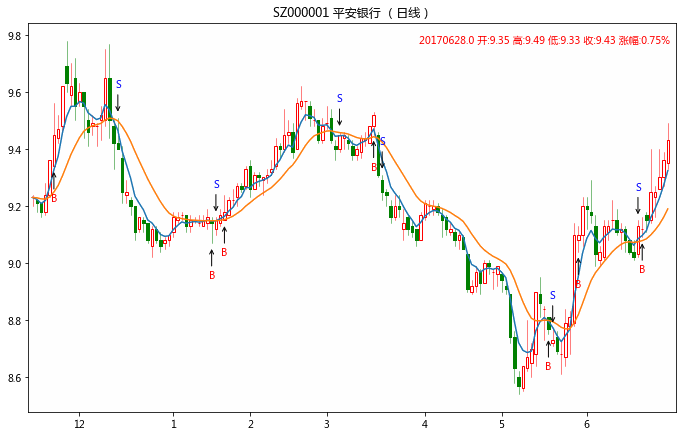
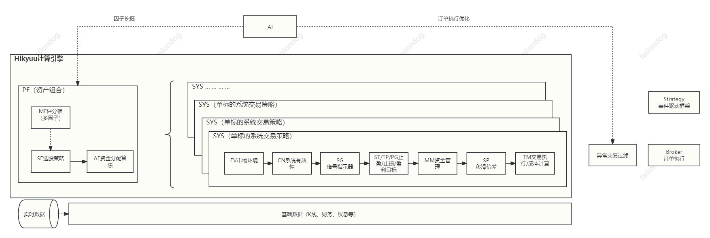

<p align="center">
  
</p>

<p align="center">
  基于 C++/Python 的开源量化回测框架 —— 成交等下一根、成本分项扣、除权要调整、杠杆默认关
</p>

<p align="center">
  
  
  
  
</p>

<p align="center">
  <a href="readme.md">English</a> | <b>简体中文</b>
</p>

**Hikyuu 的内核是「交易理论与金融语义的完整与正确」**：一笔交易在金融上该怎样成立——何时成交、成本由哪几项构成、除权时持仓与现金如何变化、绩效用什么口径——在框架里都是**完整且显式**的：环节不缺、规则被真正执行、可被逐项校验，而不是留给使用者自己保证。

**立意只有一句：不让一个「能跑通」却不成立的策略，被当成结论。**

两个手段服务于这个内核：**部件化**——把系统化交易拆成环境、条件、信号、仓位、退出、滑点、成本等可替换部件，内核才能被逐项检查；**组合即策略**——把组合做成一等公民（`SE` 选谁、`AF` 分多少钱、`MF` 打分），内核才能从单策略延伸到多资产多策略。于是每一环可独立替换与评估，每一笔都记在可查询的账本里；规则由框架执行，而不是靠你记得补（见下文「🏛️ 交易理论与金融语义」与「🧬 组合即策略」）。

> ⚠️ **免责声明**：本项目为开源金融技术研究工具，仅供个人学习、学术研究与数据分析使用，不构成任何投资建议与交易指导，不提供、不内置证券交易服务。用户自主新增、对接各类交易接口、开发拓展功能以及对应的实操行为，均由用户自行承担全部风险与法律责任，严禁对接非法交易通道、用于违规交易场景。

---

## 📊 关键数据

<p align="center">
  <table>
    <tr>
      <td align="center" width="25%">
        <strong><code>⚡ 6s / 166ms</code></strong><br>
        <sub>1913 万日 K 线加载 + 20 日均线求和：首次 / 预热后（AMD 7950x，<a href="https://mp.weixin.qq.com/s?__biz=MzkwMzY1NzYxMA==&mid=2247483768&idx=1&sn=33e40aa9633857fa7b4c7ded51c95ae7">实测详情</a>）</sub>
      </td>
      <td align="center" width="25%">
        <strong><code>🏛️ 3 类</code></strong><br>
        <sub>内建金融语义：交易理论 / 交易规则 / 计算</sub>
      </td>
      <td align="center" width="25%">
        <strong><code>🧬 3 种</code></strong><br>
        <sub>组合运行模式（A 信号聚合 / B 资金分配 / C 共享账户）</sub>
      </td>
      <td align="center" width="25%">
        <strong><code>💾 4 种</code></strong><br>
        <sub>存储方式（HDF5 / MySQL / ClickHouse / SQLite）</sub>
      </td>
    </tr>
  </table>
</p>

---

## 🔗 快速导航

| 项目                   | 链接                                                                                                                                              |
| ---------------------- | ------------------------------------------------------------------------------------------------------------------------------------------------- |
| 🏠**项目首页**   | [https://hikyuu.org/](https://hikyuu.org/)                                                                                                         |
| 📚**帮助文档**   | [https://hikyuu.readthedocs.io/zh-cn/latest/index.html](https://hikyuu.readthedocs.io/zh-cn/latest/index.html)                                     |
| 🚀**入门示例**   | [Jupyter Notebook 系列教程](https://nbviewer.org/github/fasiondog/hikyuu/blob/master/hikyuu/examples/notebook/zh/000-Index.ipynb?flush_cache=True) |
| 🧰**策略部件库** | [https://gitee.com/fasiondog/hikyuu_hub](https://gitee.com/fasiondog/hikyuu_hub)                                                                   |

---

## 🧭 入门之前：它是什么，不是什么

> **它不是自动交易工具，也不是订单执行系统**：不内置券商对接、不承诺自动下单，也不做 tick 级撮合或低延迟执行；`OrderBroker` 只是一个可插拔的接口，是否对接、对接什么通道由你自己决定并承担合规责任。它按 K 线推进，替你把一笔交易的金融语义算清楚，而不是替你在市场上做决定。

**门槛是有意保留的**：框架不会用一条漂亮的曲线，替你补上那些你没想到的前提。这些环节必须自己懂——否则得到的只是一个能跑的错觉。换个角度看，它更像一张地图：把做策略该考虑的环节逐项列出（环境 → 条件 → 信号 → 仓位 → 退出 → 滑点 → 成本；组合层：选样 → 资金分配 → 风控），照着这张图逐项填，路径本身就是入门路径。所以它更适合想把系统化交易认真学一遍的人——包括自学者与学生——而不是想两天跑出一条收益曲线的人：环节都得自己懂，框架不会替你跳过。

> 「我总在想着怎么不亏钱，而不是怎么赚钱。」—— 保罗·都铎·琼斯
>
> 这句话讲的是交易的核心，那不是框架能替你解决的。框架管的只是别把账算错：成交等下一根、成本按分项扣、权息要调整、杠杆默认关闭——这些是市场规则，不是交易之道；但连它们都算错，你检验的就根本不是策略，只是一条曲线。

给初入者与自学者的几条忠告：

- **先跑通流程，再谈收益**：回测收益率不是能力证明，能解释每一笔为什么成交才是。
- **一次只改一个部件**：其他环节固定不动做对照，否则无法知道收益变化来自哪里。
- **先有成本与权息，再调参数**：没有成本约束下的最优参数，往往只是拟合噪声。
- **关心「什么环境下失效」**：比关心「历史赚了多少」更有用；用样本外与走步验证（`SYS_WalkForward`）检验，而不是在同一个区间反复调参。
- **默认关掉的要慎用**：杠杆、做空默认关闭是刻意的，先弄清保证金、强平与借券成本，再显式打开。

---

## ⚡ 快速开始（跑通第一个回测）

### 环境要求

- **Python 3.10+**（官方包仅面向 3.10 ~ 3.13 构建）
- 支持 Windows / Linux / macOS（Linux 需 Ubuntu 24.04+）

### 第 1 步：安装

```bash
pip install hikyuu
```

国内用户若下载缓慢，可换用镜像源：

```bash
pip install hikyuu -i https://pypi.tuna.tsinghua.edu.cn/simple
```

### 第 2 步：导入行情数据

任选一种方式导入 A 股历史行情数据：

```bash
# 图形界面（推荐首次使用，会自动生成配置文件）
HikyuuTDX

# 命令行（需先运行过一次 HikyuuTDX 生成配置）
importdata
```

### 第 3 步：跑通第一个回测

```python
from hikyuu.interactive import *

# 创建模拟交易账户进行回测，初始资金 30 万
my_tm = crtTM(init_cash=300000)

# 创建信号指示器（以 5 日 EMA 为快线，其 10 日 EMA 为慢线）
# 快线向上穿越慢线时买入，反之卖出
my_sg = SG_Flex(EMA(CLOSE(), n=5), slow_n=10)

# 固定每次买入 1000 股
my_mm = MM_FixedCount(1000)

# 创建交易系统并运行
sys = SYS_Simple(tm=my_tm, sg=my_sg, mm=my_mm)
sys.run(sm['sz000001'], Query(-150))
```

<p align="center">
  
</p>

> 📖 完整示例参见 [Jupyter Notebook 系列教程](https://nbviewer.org/github/fasiondog/hikyuu/blob/master/hikyuu/examples/notebook/zh/000-Index.ipynb?flush_cache=True)
>
> 跑通单系统之后，下一步就是把多个策略组成一个组合：见下文「🧬 组合即策略」。

---

## 🏛️ 交易理论与金融语义的完整与正确

> 三层，各管一件事，缺一层就不成立：**交易理论**——环节不能缺，缺了组合层，多策略就只是并行回测；**交易规则**——规则不能错，缺了权息与分项成本，除权日与跨年收益就会失真，缺了成交时机约束，信号当根成交就是前视；**计算**——空值语义必须一致，若由各指标自行处置，一个 `inf` 就会污染下游所有窗口聚合。这三层在框架里都是显式对象与全局约定——不靠文档提醒，而靠框架执行与入口守卫。

| 层面 | 内建语义 |
| :--- | :--- |
| 交易理论 | 系统化交易的每个环节都是一等公民：市场状态 `EV`、系统有效性 `CN`、信号 `SG`、资金管控 `MM`、止损 `ST`、止盈 `TP`、盈利目标 `PG`、滑点 `SP`；投资组合层同理：选样 `SE`、资金分配 `AF`（L1 权重 / L2 换算 / L3 组合风控）、多因子打分 `MF`。每一环有独立部件、可单独替换与单独评估，因此组装策略的过程就是逐项回答理论要求回答的问题 |
| 交易规则 | 成交默认延迟到下一根开盘（`buy_delay` / `sell_delay`），一价板或当日零成交（停牌）顺延、超过 `max_delay_count` 放弃，滑点价钳制在当日 `[low, high]`；成本按 `CostRecord` 分项（佣金 / 印花税 / 过户费 / 其他）买卖分别计算；`updateWithWeight` 按权息调整持仓与现金，除权不产生虚假盈亏；融资融券（`support_borrow_cash` / `support_borrow_stock`）默认关闭；绩效用净资产口径、自然日年化（`duration / 365`） |
| 计算 | 空值与非有限值在整套计算里同一处理：未定义状态（除零 / 零方差 / 全缺失窗口 / 零基准）产 `Null`（NaN）而**不是** `0.0` 或 `inf`——`0.0` 会与合法的零撞车，`inf` 会污染下游每个窗口聚合；窗口聚合只累加有限值、分母只数有效项（均值类需 1 个、离差类需 2 个），窗口全缺才产 `Null`；序列化按 IEEE 位模式保存，NaN / ±Inf / 符号零无损往返。同一套约束延续到交易输入：买入数量非有限或 ≤ 0、成交价最终非正，该笔放弃；调仓周期为负在创建时即抛异常 |

上面三类都不是文档承诺，而是被测试与入口校验钉住的：核心代码 1700+ 处入口校验（`HKU_CHECK` / `HKU_ASSERT` / `HKU_THROW`）拦住交易规则与输入边界；doctest 单元用例 1600+ 个、断言近 1.5 万条，测试代码与核心代码规模约 1:1.7，按「一模块一套件、一边界一用例」组织——因此每个部件都有独立套件，空输入、`Null<T>()`、非有限值与越界异常路径都在覆盖范围内。`small-test` 不依赖真实行情即可在 Windows / Ubuntu / macOS 三平台 CI 上跑通。

> 要绕过这些规则，只能显式改参数——**框架选择站在「交易上成立」这一边，而不是「跑起来最省事」这一边**。这也是同一策略在不同框架上跑出不同收益的常见原因：没被建模的环节，结果就取决于使用者是否记得补。

> 这套取舍有代价：同一策略跑出的收益，通常低于理想化回测——费用扣了、成交等了、权息调整了。宁可让回测数字难看，也不让一个能跑却错误的结果变成可用的策略。

---

## 🧬 组合即策略：一个引擎覆盖系统化交易 / 资产配置 / 多因子

**组合与策略是同一件事**：一个组合节点不是「一组权重」，而是同样持有一套完整的交易语义——子系统各自的 `EV` / `CN` / `SG` / `MM` / `ST` / `TP` / `PG` / `SP` 决定「怎么打」，账本（`TM`）逐笔记录成交与持仓，按分项计算成本（佣金 / 印花税 / 过户费）、按权息调整，执行层负责延迟到下一根成交、失败重试与停牌处理——这三层语义在组合节点上依然成立，只在最外层合并为同一账户。

组合层因此只回答投资组合该回答的两个问题：**谁参与**（`SE` 选样、`MF` 多因子打分）与**分多少钱**（`AF` 的 L1 权重 / L2 换算 / L3 组合风控）。

这不是命名上的讲究，而是三个可以直接用的结果：

- **节点 = 完整交易系统，不是资金分配口** —— 因此单系统、走步优化系统、自定义 Python 系统，乃至组合本身，都能直接挂成父组合的节点，不必为它们写适配层，嵌套深度也没有上限。
- **金融语义下沉到每个节点** —— 因此子系统里的止损、分项成本、权息与延迟成交照旧成立，不需要因为进了组合就重写一遍，只在最外层合并为同一账户。
- **`AF` 的三层是正交的** —— 因此换权重来源（`AF_EqualWeight` / `AF_FixedWeightList` / `AF_MultiFactor`）不必动组合风控，改 L3 风控也不必动 L1 权重，三者可独立替换与单独评估。完整清单见下文「🏗️ 交易系统化架构核心部件」。

```python
from hikyuu.interactive import *

# 1. 每个子系统都是一套完整的系统化交易：各自的 SG / MM / ST 与账本
def make_leaf(code, sg):
    sys = SYS_Simple(tm=crtTM(init_cash=100000), sg=sg,
                     mm=MM_FixedPercent(0.5), st=ST_FixedPercent(0.05))
    sys.to = sm[code].get_kdata(Query(-500))    # 绑定自身 K 线
    return sys

trend = make_leaf("sh600000", SG_Cross(EMA(CLOSE(), n=5), MA(CLOSE(), n=60)))
grid = make_leaf("sh600004", SG_Cross(EMA(CLOSE(), n=3), MA(CLOSE(), n=10)))

# 2. 组合工厂只做投资组合该做的事：谁参与（SE）+ 分多少钱（AF）
group = PF_SignalAggregate(tm=crtTM(Datetime(202001010000), 300000), adjust_cycle=5)
group.add(trend)
group.add(grid)

# 3. 这个组合还能作为节点参与更大的组合（多资产多策略的逐层聚合）
top = PF_Simple(tm=crtTM(Datetime(202001010000), 1000000),
                af=AF_FixedWeightList([0.6, 0.4]), adjust_cycle=5)
top.add(group)
top.add(make_leaf("sh600005", SG_Cross(EMA(CLOSE(), n=10), MA(CLOSE(), n=30))))

# 4. 一次运行，整个组合在同一账户内统一结算
top.run(Query(-500))
print(top.tm.get_funds().total_assets)
```

同一套引擎同时支持三种组合运行模式，各有对应工厂（也可用 `set_mode` 在已建组合上显式切换）：

| 工厂 | 账户形态与资金流转 | 对应的方法论 | 典型场景 |
| :--- | :--- | :--- | :--- |
| `PF_SignalAggregate`（模式 A） | 子系统用固定影子账户只作信号源；父按 `AF` 的 L2 换算把子系统的意图折算为执行指令，经 L3 组合风控后统一下单 | 信号 / 观点融合与组合构建；多因子打分可作选样或权重来源 | 多策略观点叠加到同一标的池、因子加权选股 |
| `PF_Simple`（模式 B） | 调仓日由 `AF` 给每个子系统划拨额度，子系统在额度内自主决策，父透传其指令 | 资产配置与再平衡：权重 / 风险预算 / 调仓周期 | FOF / MOM、核心-卫星、定期再平衡 |
| `PF_WithoutAF`（模式 C） | 不建影子账户，子系统直接在父的真实账户上按自身 MM 交易 | 系统化交易的并行执行：每个系统保留完整决策链 | 复现旧 `Portfolio` 回测口径、多策略共享资金池 |

三种模式并不互斥：同一组合里可以替换 `SE` / `AF` / `MF`，也可以把一种模式的组合作为另一种模式的节点（例如外层 B 给内层 A 划拨额度），逐层组合。多因子不是单独的一层开关，而是通过 `SE_MultiFactor`（打分选样）与 `AF_MultiFactor`（按 `SE` 的评分分配权重）接入 A / B 两条路径。

调仓日由 `set_adjust_cycle(n)`（按交易日或多周期计数）或 `set_adjust_dates([...])`（显式日期表）指定。调仓日上，子系统的现金会被回收并由 `AF` 重新划拨，因此某个子系统止损 / 止盈释放出的资金，会在下一次调仓日回流到组合层再分配；`set_adjust_cycle(1)` 即为每个交易日结算。

> ⚠️ 两个前提：每个子系统需持有各自独立的 SG / MM 实例（共享同一 SG 会被互相覆盖）；用 `run(kdata)` 驱动时，各子系统需已绑定自身 K 线，若希望由交易日历驱动整个组合，直接用 `run(Query(...))` 即可。

> ℹ️ 架构上支持多市场、多资产；内置数据导入目前覆盖 A 股，其他市场与资产可通过自定义数据驱动或插件接入。

### 与常见做法的差异

> 两类常见做法各自更适合不同的工作流，差别在于这些环节由谁承担：一类是事件驱动框架里把多个策略并列跑在同一个账户上，组合层并没有被建模——选谁、分多少钱、什么时候再平衡，都要用户自己写一层包装；另一类是把信号 / 因子做成矩阵交给优化器或模型，得到一组权重，而权重背后的下单数量、止损止盈、成交时机与成本由另设的执行层承担，不与策略抽象合一。

| 维度 | 事件驱动多策略并列 | 向量化因子 / 信号研究 | Hikyuu |
| :--- | :--- | :--- | :--- |
| 层级模型 | 多策略并列共享一个账户，无组合层 | 信号矩阵 → 组合权重 → 独立执行器 | 组合与策略同构，可任意深度嵌套 |
| 组合层职责 | 用户手写包装层做资金分配与再平衡 | 权重在优化器 / 模型层给出 | `SE` 选样 + `AF`（L1 权重 / L2 换算 / L3 风控）+ `MF` 打分内建 |
| 交易语义 | 由每个策略自行实现 | 由独立执行层承担，不与策略抽象合一 | `EV` / `CN` / `SG` / `MM` / `ST` / `TP` / `PG` / `SP` + 分项成本、权息、延迟成交与重试 |
| 状态同步 | 共享现金池，子系统间只能间接影响 | 无逐日状态机 | 同一根 K 线的开盘 / 收盘阶段，父账户统一记账 |
| 计算内核 | 多为解释型实现 | 向量化加速 | C++ 内核 + 原生多线程，可选 SIMD 向量化编译 |

如果你只想在向量化环境里做因子研究，后两者的分工未必是问题；Hikyuu 的选择是把组合层与交易语义都纳入同一套抽象，代价是要多理解一层结构。

**部件契约统一，因此可以被外部接管**：所有部件共享同一套契约——可 `clone`、可序列化、参数可枚举。因此外部优化器或 AI 只需接管其中一环——`SG` 回答买卖与否、`MM` 回答数量、`ST` 回答退出价位、`AF` 回答权重——而账户、撮合、分项成本与权息仍由引擎维护，不必替你重算一遍金融语义。便于外挂网格 / 贝叶斯 / 遗传等优化器。**走步优化已内置**（`SYS_WalkForward` 配合 `SE_MaxFundsOptimal` / `SE_PerformanceOptimal` / `SE_EvaluateOptimal` 选择器），框架不提供强化学习训练环境。

> 组合嵌套 × 参数搜索意味着成千上万次回测——这才是 C++ 内核、原生多线程与可选 SIMD 向量化在这里的实际用途：不是炫技，而是让「逐层嵌套 + 反复调参」跑得动。

---

## 🏗️ 交易系统化架构核心部件

> 项目由 **C++ 核心库**、**Python 接口层**、**交互式探索工具** 三部分构成，每个部件可独立替换、自由组合
>
> 数据层支持 **HDF5 / MySQL / ClickHouse / SQLite** 四种存储（默认 HDF5；ClickHouse 经插件扩展，分钟级数据的读写快于 HDF5、空间占用远低于 MySQL，更适配分钟级及以下高频数据）。

<p align="center">
  
</p>

| 层级                   | 部件                           | 说明                           |
| :--------------------- | :----------------------------- | :----------------------------- |
| **投资组合层**   | `PF_*`（组合工厂，`Portfolio` 为兼容别名） | 多资产多策略组合：选样、资金分配与统一记账 |
|                        | `Selector / SE`              | 系统对象选择：系统策略筛选     |
|                        | `AllocateFunds / AF`         | 资金分配：组合级 L1 权重 / L2 换算 / L3 风控 |
|                        | `MultiFactor / MF`           | 多因子模型：因子评分与排序     |
| **交易系统 SYS** | `Environment / EV`           | 市场环境：大盘环境有效性判断   |
|                        | `Condition / CN`             | 系统有效条件：系统适用条件     |
|                        | `Signal / SG`                | 信号指示器：产生买卖信号       |
|                        | `MoneyManager / MM`          | 资金管理：买卖数量控制         |
|                        | `Stoploss / ST`              | 止损：风险控制退出             |
|                        | `Takeprofit / TP`            | 止盈：达到目标价位退出         |
|                        | `ProfitGoal / PG`            | 盈利目标：目标达成退出         |
|                        | `Slippage / SP`              | 滑点：回测价格模拟             |
| **交易管理**     | `TradeManager / TM`          | 交易管理：账户资金与持仓记录   |
|                        | `OrderBroker / OB`           | 订单执行：实盘下单 broker 对接 |
| **数据层**       | `StockManager`               | 证券统一管理                   |
|                        | `KData`                      | K 线量价序列                   |
|                        | `Query`                      | 时间范围查询筛选               |

---

## 📂 浏览源码

> 欢迎 **Star ⭐**，参与贡献

| 平台                 | 链接                                                                      | 推荐        |
| :------------------- | :------------------------------------------------------------------------ | :---------- |
| **GitHub**     | [https://github.com/fasiondog/hikyuu](https://github.com/fasiondog/hikyuu) | 海外        |
| **码云 Gitee** | [https://gitee.com/fasiondog/hikyuu](https://gitee.com/fasiondog/hikyuu)   | ✅ 国内推荐 |
| **GitCode**    | [https://gitcode.com/hikyuu/hikyuu](https://gitcode.com/hikyuu/hikyuu)     | ✅ 国内推荐 |

---

## ❤️ 感谢捐赠，让 Hikyuu 走得更远

| 方案                       | 说明                                                                                                                     | 方式                | 链接                                   |
| :------------------------- | :----------------------------------------------------------------------------------------------------------------------- | :------------------ | :------------------------------------- |
| ☕**请作者喝杯咖啡** | ¥30 · 一次性的小小支持（赠历史日线及 3 个月捐赠权益）                                                                  | 支付宝              | [前往捐赠](https://wzyp.cn/item/gflv3v) |
| 📅**订阅 180 天**    | ¥50 · 半年期捐赠权益（赠历史日线）                                                                                     | 支付宝              | [前往捐赠](https://wzyp.cn/item/du4h8s) |
| 🗓️**订阅 365 天**  | ¥100 · 全年期捐赠权益（赠历史日 / 分 / 时 / 笔数据）                                                                   | 支付宝              | [前往捐赠](https://wzyp.cn/item/ehbz9b) |
| 🌌**加入知识星球**   | ¥300/年 · 首年 300 元，续费半价；捐赠权益 1 年可 3 台设备登录 · 专属微信群及策略部件库（赠历史日 / 分 / 时 / 笔数据） | 微信 / 知识星球 APP | [前往加入](https://t.zsxq.com/YSATD)    |

> 🎁 **捐赠计划与附赠详见**：[https://hikyuu.readthedocs.io/zh-cn/latest/vip/donate-plan.html](https://hikyuu.readthedocs.io/zh-cn/latest/vip/donate-plan.html)

捐赠用户支持群（仅接受捐赠用户，入群请注明：Hikyuu 订阅）

<p align="center">
  
</p>

---

## 🌟 需要的帮助

欢迎社区成员一起参与贡献：

- 🐛 测试并反馈 Bug
- 📝 编写文档
- 🔧 开发新功能
- 🎨 网站优化

> 💡 **建议通过在 GitHub / Gitee / GitCode 开 issue 的方式贡献以上内容**

---

## 📦 项目依赖说明

C++ 核心模块直接依赖的开源项目、项目地址及 License 已汇总至 [THIRD_PARTY_LICENSES.md](THIRD_PARTY_LICENSES.md)（间接依赖未列出），在此向所有开源作者致敬 👍

Python 侧依赖见 [requirements.txt](requirements.txt)。

---

## 🛠️ 工程与架构

对想二次开发或长期维护的人，以下几项是可直接查证的：

- **C++20 + xmake**：Windows / Ubuntu / macOS 三平台 CI；第三方依赖及其许可汇总于 `THIRD_PARTY_LICENSES.md`
- **三档测试**：`small-test`（CI 默认，不依赖真实行情）/ `unit-test` / `real-test`（需真实行情数据），另有 `-m coverage` 生成 lcov 报告
- **C++ 核心可独立剥离**：`hikyuu_cpp/hikyuu` 是独立的构建目标，不套 Python 也可基于它自建工具
- **双语文档**：`docs/zh` 与 `docs/en` 结构一致，核心 C++ / Python 注释与 docstring 已英文化

---

## Star History

<a href="https://www.star-history.com/?repos=fasiondog%2Fhikyuu&type=date&legend=top-left">
 <picture>
   <source media="(prefers-color-scheme: dark)" srcset="https://api.star-history.com/chart?repos=fasiondog/hikyuu&type=date&theme=dark&legend=top-left" />
   <source media="(prefers-color-scheme: light)" srcset="https://api.star-history.com/chart?repos=fasiondog/hikyuu&type=date&legend=top-left" />
   
 </picture>
</a>
